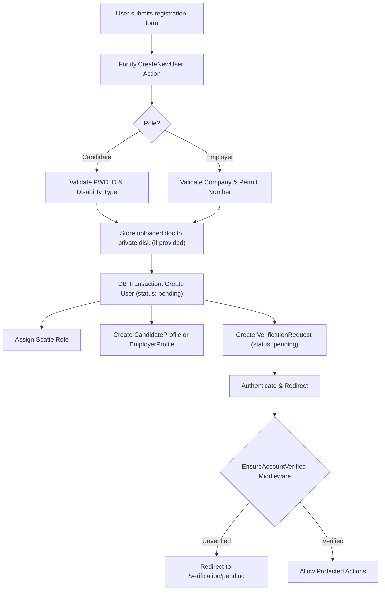

# Implementation Plan: Registration Redesign & Unverified Account Gate Middleware

**Target Window:** Nov 11–13, 2026 (Track A Critical Path)  
**Requirement IDs:** [AUTH-01](file:///C:/Users/ay/Projects/pwd-e/pwd-e-app/docs/REQUIREMENTS.md#L94), [AUTH-02](file:///C:/Users/ay/Projects/pwd-e/pwd-e-app/docs/REQUIREMENTS.md#L95), [AUTH-03](file:///C:/Users/ay/Projects/pwd-e/pwd-e-app/docs/REQUIREMENTS.md#L96), [AUTH-04](file:///C:/Users/ay/Projects/pwd-e/pwd-e-app/docs/REQUIREMENTS.md#L97), [AUTH-08](file:///C:/Users/ay/Projects/pwd-e/pwd-e-app/docs/REQUIREMENTS.md#L101), [AUTH-09](file:///C:/Users/ay/Projects/pwd-e/pwd-e-app/docs/REQUIREMENTS.md#L102), [SEC-01](file:///C:/Users/ay/Projects/pwd-e/pwd-e-app/docs/REQUIREMENTS.md#L302), [SEC-02](file:///C:/Users/ay/Projects/pwd-e/pwd-e-app/docs/REQUIREMENTS.md#L303), [UX-01](file:///C:/Users/ay/Projects/pwd-e/pwd-e-app/docs/REQUIREMENTS.md#L328)

---

## Goal Description

The registration flow currently uses Laravel Fortify's default single-role template without support for candidate vs. employer distinction, PWD ID collection, or business permit verification. Because all downstream modules (Tracks B, C, and D) depend on users having distinct roles, initial profile records, and verification states, this task delivers:

1. **Mobile-First 1:1 Registration UI**: An accessible registration page matching the existing design language of [`login.blade.php`](file:///C:/Users/ay/Projects/pwd-e/pwd-e-app/resources/views/livewire/auth/login.blade.php) with an accessible role switcher (Candidate / Employer) and conditional fields.
2. **Multi-Role User & Profile Provisioning**: Update [`CreateNewUser.php`](file:///C:/Users/ay/Projects/pwd-e/pwd-e-app/app/Actions/Fortify/CreateNewUser.php) to validate role-specific fields, store uploaded verification documents on a private disk, create `CandidateProfile` or `EmployerProfile` rows inside a database transaction, and generate an initial `VerificationRequest`.
3. **Unverified Account Gate Middleware**: Create an `EnsureAccountVerified` middleware that blocks unverified candidates and employers from executing restricted actions (e.g., submitting applications or publishing job postings) and routes them to a clear "Pending Verification" notice screen.

---

## User Review Required

> [!IMPORTANT]
> **File Uploads During Registration vs. Post-Registration**:
> PWD ID and Business Permit document uploads will be accepted at registration, but marked **optional at the exact moment of signup** (with the ID / Permit *number* being mandatory). If a candidate or employer registers without attaching the document, they can log in but cannot submit applications or post jobs until they upload their document on their pending verification dashboard.

> [!WARNING]
> **Account Status Behavior**:
> New accounts are created with `status = 'pending'` and `verified_at = null`. Under Philippine Data Privacy Act (RA 10173), disability identifiers (`pwd_id_number`, `disability_type`) are stored using Laravel encrypted casts.

---

## Open Questions

1. **Disability Taxonomy**: Should the registration dropdown use the 8 standard categories (`Physical/Motor`, `Visual`, `Hearing`, `Speech`, `Cerebral Palsy`, `Psychosocial`, `Intellectual`, `Multiple`)?  
   *(Default assumption: Yes, based on the interview findings).*
2. **Immediate Login vs. Gate Screen**: Should Fortify log the user in immediately upon registration and let the middleware redirect them to `/verification/pending`, or should registration redirect them to `/login` with an alert?  
   *(Default assumption: Log in immediately and redirect to `/verification/pending` so the user can see their submitted details and confirmation).*

---

## Proposed Changes



---

### Layer 1: Database & Migrations

#### [NEW] `database/migrations/2026_11_12_000001_add_pwd_id_to_users.php`
- Adds `pwd_id_number` (nullable, encrypted in model) and `pwd_id_path` (nullable, string) to `users`.

#### [NEW] `database/migrations/2026_11_12_000002_add_verification_to_employer_profiles.php`
- Adds `business_permit_number` (nullable, string), `business_permit_path` (nullable, string), and `verified_at` (nullable, timestamp) to `employer_profiles`.

#### [NEW] `database/migrations/2026_11_12_000003_add_disability_type_to_candidate_profiles.php`
- Adds `disability_type` (nullable, encrypted string) and `resume_pdf_path` (nullable, string) to `candidate_profiles`.

---

### Layer 2: Models & Casts

#### [MODIFY] [`app/Models/User.php`](file:///C:/Users/ay/Projects/pwd-e/pwd-e-app/app/Models/User.php)
- Add `pwd_id_number` and `pwd_id_path` to `#[Fillable]`.
- Add `'pwd_id_number' => 'encrypted'` in `casts()`.
- Add helper method `isVerified(): bool` returning `$this->verified_at !== null && $this->status === 'active'`.

#### [MODIFY] [`app/Models/CandidateProfile.php`](file:///C:/Users/ay/Projects/pwd-e/pwd-e-app/app/Models/CandidateProfile.php)
- Add `disability_type` and `resume_pdf_path` to `$fillable`.
- Add `'disability_type' => 'encrypted'` to `$casts`.

#### [MODIFY] [`app/Models/EmployerProfile.php`](file:///C:/Users/ay/Projects/pwd-e/pwd-e-app/app/Models/EmployerProfile.php)
- Add `business_permit_number`, `business_permit_path`, and `verified_at` to `$fillable`.
- Add `'verified_at' => 'datetime'` to `$casts`.

---

### Layer 3: Registration View & Client Interaction

#### [MODIFY] [`resources/views/livewire/auth/register.blade.php`](file:///C:/Users/ay/Projects/pwd-e/pwd-e-app/resources/views/livewire/auth/register.blade.php)
- Redesign layout 1:1 with [`login.blade.php`](file:///C:/Users/ay/Projects/pwd-e/pwd-e-app/resources/views/livewire/auth/login.blade.php):
  - Retain top bar with semantic links, logo, and sign-in button.
  - Retain `<x-accessibility-panel />`.
  - Left column: Promotional info with accessibility badge and RA 10173 data privacy commitment.
  - Right column: Multi-role registration card.
- Accessible Role Switcher (`x-data="{ role: 'candidate' }"`):
  - Segmented control / radio group: `Candidate (PWD Job Seeker)` vs `Employer (Hiring Partner)`.
  - `role="radiogroup"` with explicit keyboard navigation and active state styling.
- Form inputs:
  - Common: Name, Email Address, Password, Password Confirmation.
  - Candidate specific (visible when `role === 'candidate'`):
    - Disability Type dropdown (`Visual`, `Hearing`, `Motor/Physical`, `Speech`, `Cerebral Palsy`, `Psychosocial`, `Intellectual`, `Multiple`).
    - PWD ID Number input (with sample format helper text).
    - Optional PWD ID file upload (`accept=".jpg,.jpeg,.png,.pdf"`).
  - Employer specific (visible when `role === 'employer'`):
    - Company Name input.
    - Business Permit / SEC Number input.
    - Optional Business Permit file upload (`accept=".jpg,.jpeg,.png,.pdf"`).
- Attributes: Form uses `method="POST" action="{{ route('register.store') }}" enctype="multipart/form-data" novalidate`.
- Accessibility: Minimum 48px touch targets, visible focus indicators, screen-reader alert banners for validation errors.

---

### Layer 4: Fortify Action & Transaction Workflow

#### [MODIFY] [`app/Actions/Fortify/CreateNewUser.php`](file:///C:/Users/ay/Projects/pwd-e/pwd-e-app/app/Actions/Fortify/CreateNewUser.php)
- Refactor `create(array $input)`:
  1. Validate role-conditional rules:
     ```php
     $rules = [
         'role' => ['required', 'string', 'in:candidate,employer'],
         'name' => ['required', 'string', 'max:255'],
         'email' => ['required', 'string', 'email', 'max:255', 'unique:users'],
         'password' => $this->passwordRules(),
     ];
     if (($input['role'] ?? '') === 'candidate') {
         $rules['pwd_id_number'] = ['required', 'string', 'max:50'];
         $rules['disability_type'] = ['required', 'string', 'max:100'];
         $rules['pwd_id_file'] = ['nullable', 'file', 'mimes:jpg,jpeg,png,pdf', 'max:5120'];
     } elseif (($input['role'] ?? '') === 'employer') {
         $rules['company_name'] = ['required', 'string', 'max:255'];
         $rules['business_permit_number'] = ['required', 'string', 'max:100'];
         $rules['business_permit_file'] = ['nullable', 'file', 'mimes:jpg,jpeg,png,pdf', 'max:5120'];
     }
     ```
  2. Handle file uploads to the `private` disk:
     - `pwd_id_path = $request->file('pwd_id_file')?->store('documents/pwd_ids', 'private')`
     - `business_permit_path = $request->file('business_permit_file')?->store('documents/permits', 'private')`
  3. Run inside `DB::transaction()`:
     - Create `User` (`role = $input['role']`, `status = 'pending'`, `verified_at = null`, `pwd_id_number`, `pwd_id_path`).
     - Assign Spatie role: `$user->assignRole($input['role'])`.
     - If candidate: create `CandidateProfile` (`user_id`, `disability_type`).
     - If employer: create `EmployerProfile` (`user_id`, `company_name`, `business_permit_number`, `business_permit_path`).
     - Create initial `VerificationRequest` record linking user, type, document path, and status `pending`.

---

### Layer 5: Middleware & Gated Views

#### [NEW] `app/Http/Middleware/EnsureAccountVerified.php`
- Checks whether the authenticated user has completed verification:
  ```php
  if (! $request->user()) {
      return redirect()->route('login');
  }
  if ($request->user()->hasRole('admin')) {
      return $next($request);
  }
  if ($request->user()->status === 'suspended') {
      Auth::logout();
      return redirect()->route('login')->withErrors(['email' => 'Your account has been suspended.']);
  }
  if (! $request->user()->isVerified()) {
      if ($request->expectsJson()) {
          abort(403, 'Your account is pending verification.');
      }
      return redirect()->route('verification.notice');
  }
  return $next($request);
  ```

#### [MODIFY] [`bootstrap/app.php`](file:///C:/Users/ay/Projects/pwd-e/pwd-e-app/bootstrap/app.php)
- Register middleware alias:
  ```php
  $middleware->alias([
      'account.verified' => \App\Http\Middleware\EnsureAccountVerified::class,
  ]);
  ```

#### [NEW] `resources/views/auth/verification-pending.blade.php`
- Clean, accessible status screen showing:
  - Account status badge ("Under Review by PESO/LGU Admin").
  - Submitted document details and ID number.
  - Option to re-upload / upload missing document if not provided at signup.
  - Contact support & sign out buttons.

#### [MODIFY] [`routes/web.php`](file:///C:/Users/ay/Projects/pwd-e/pwd-e-app/routes/web.php)
- Add route for `verification.notice`:
  ```php
  Route::get('/verification/pending', function () {
      return view('auth.verification-pending');
  })->middleware('auth')->name('verification.notice');
  ```
- Protect candidate application and employer posting routes with `['auth', 'account.verified']`.

---

## Verification Plan

### Automated Tests
Run via PowerShell:
```powershell
cd C:\Users\ay\Projects\pwd-e\pwd-e-app
php artisan test --filter=RegistrationTest
php artisan test --filter=AccountVerificationGateTest
./vendor/bin/pint --test
```

New/updated tests:
1. `tests/Feature/Auth/RegistrationTest.php`:
   - `test_candidate_can_register_with_pwd_id_and_creates_profile()`
   - `test_employer_can_register_with_permit_and_creates_profile()`
   - `test_registration_fails_without_required_role_fields()`
2. `tests/Feature/Auth/AccountVerificationGateTest.php`:
   - `test_unverified_user_is_redirected_to_pending_notice()`
   - `test_verified_user_can_access_gated_routes()`
   - `test_admin_bypasses_verification_gate()`

### Manual Verification
1. Open browser at `/register`.
2. Verify role toggle switches between Candidate and Employer without page reload.
3. Test keyboard navigation across role radio buttons and input fields.
4. Register a candidate with PWD ID:
   - Check that `User`, `CandidateProfile`, and `VerificationRequest` records are created in PostgreSQL with status `pending`.
   - Verify redirection to `/verification/pending`.
5. Register an employer with permit:
   - Check that `User`, `EmployerProfile`, and `VerificationRequest` records are created in PostgreSQL.
6. Attempt to access a gated route as an unverified user and confirm redirection.
