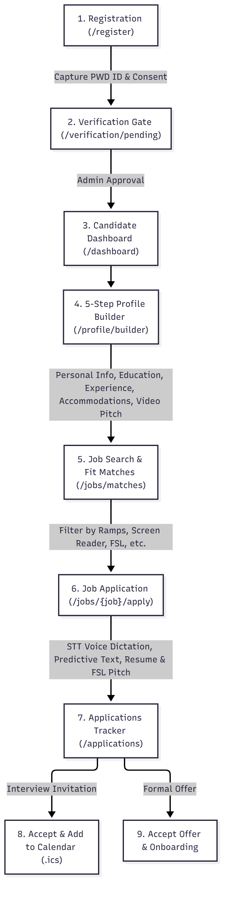
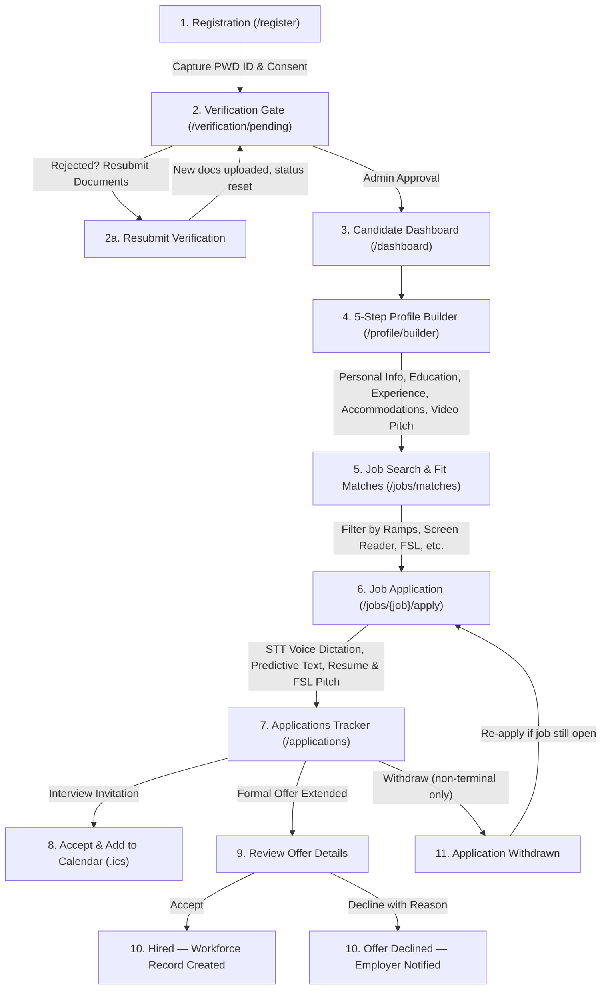
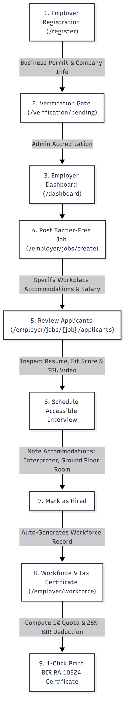
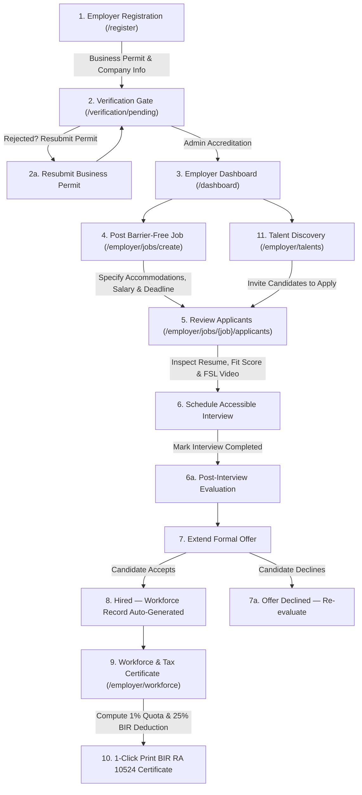
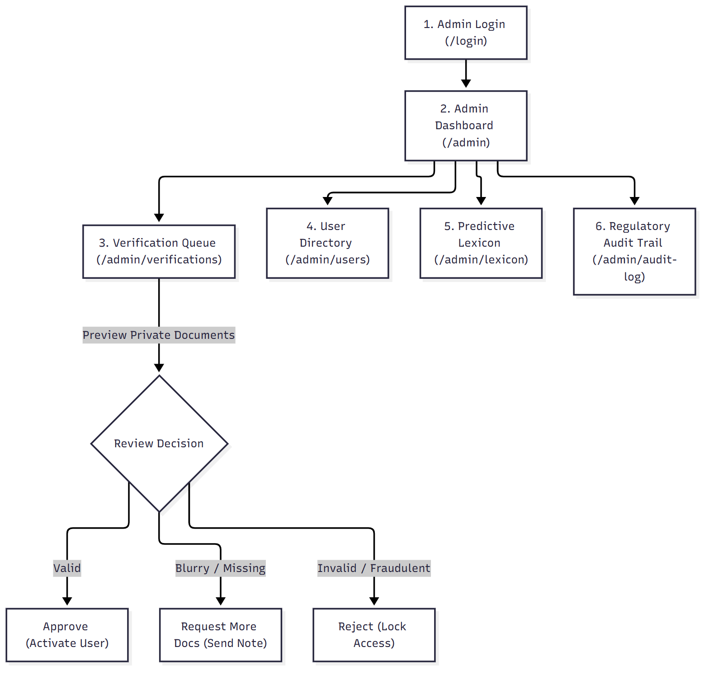
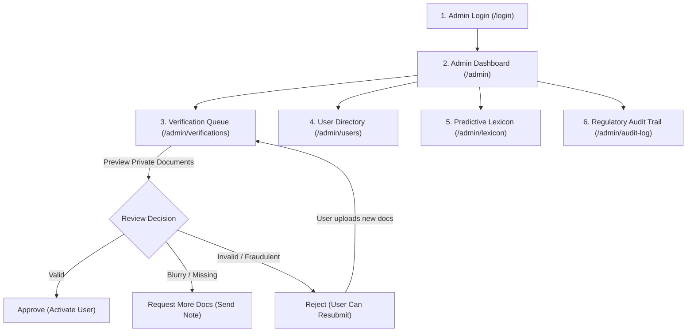
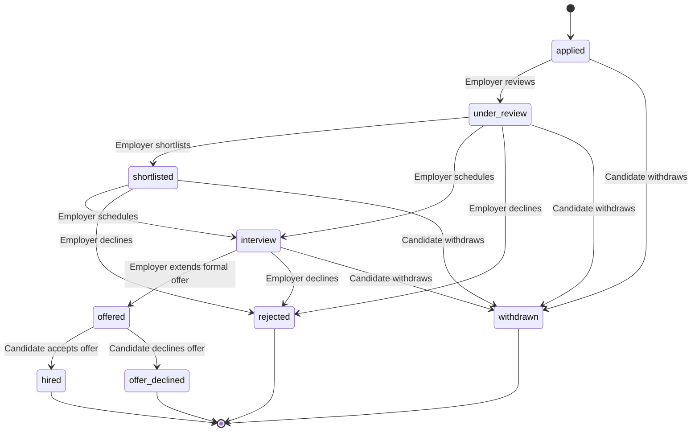

# PWD-E System Workflows & End-to-End User Journeys

This document outlines the complete, production-grade workflows of the **PWD-E Platform** across all three core user roles: **Candidate (Persons with Disabilities)**, **Employer**, and **System Administrator (PESO / LGU Compliance Officer)**.

---

## 1. System Persona & Access Matrix

| Role | Primary Objectives | Key Routes & Components | Regulatory Authority |
|---|---|---|---|
| **Candidate (PWD)** | Register with PWD ID, build accessible profile, search accommodation-filtered jobs, apply via STT/FSL, track hiring status, accept/decline formal offers. | `/register`<br>`/profile/builder`<br>`/jobs/matches`<br>`/jobs/{job}/apply`<br>`/applications` | **RA 7277** (Magna Carta for Disabled Persons)<br>**RA 10754** (PWD Benefits)<br>**RA 11106** (Filipino Sign Language Act)<br>**RA 10173** (Data Privacy Act) |
| **Employer** | Register business entity, post accessible opportunities, review applicants, schedule accommodations, extend formal offers, hire talent, claim statutory tax incentives. | `/register`<br>`/employer/jobs`<br>`/employer/jobs/create`<br>`/employer/jobs/{job}/applicants`<br>`/employer/talents`<br>`/employer/workforce` | **RA 10524** (Positions Reserved for PWDs)<br>**BIR RA 10524 / RA 7277 §8** (25% gross wage deduction & 50% accessibility deduction) |
| **Administrator (PESO / LGU)** | Review statutory KYC credentials (PWD ID & Business Permit), monitor compliance, manage predictive assistive lexicon, inspect audit logs. | `/admin`<br>`/admin/verifications`<br>`/admin/users`<br>`/admin/lexicon`<br>`/admin/audit-log` | **DOLE PESO Accreditation**<br>**NCDA / PDAO Guidelines** |

### Route-Level Security & Middleware Stack

| Route Group | Middleware Chain | Purpose |
|---|---|---|
| `/admin/*` | `auth` → `role:admin` | Only authenticated admins can reach admin endpoints |
| `/profile/*`, `/jobs/*`, `/applications` | `auth` → `account.verified` → `role:candidate` | Candidates only; verified account required |
| `/employer/*` | `auth` → `account.verified` → `role:employer` | Employers only; verified account required |
| `/employer/jobs/create`, `/employer/jobs/{job}/edit` | Above + `employer.permit` | Requires approved business permit before job creation/editing |

---

## 2. Candidate Workflow (Jobseeker with Disability)



<details>
<summary><b>View Mermaid Diagram Source</b></summary>



</details>

### Detailed Steps:
1. **Registration & Statutory KYC:**
   - Navigates to `/register` and selects **Candidate (PWD)**.
   - Enters Full Name, Email, Password, and Date of Birth (must be $\ge 18$ years old per DOLE Labor Code).
   - Selects Disability Type (Visual, Hearing, Motor/Physical, Speech, Cerebral Palsy, Psychosocial, Intellectual, Multiple).
   - Enters LGU/PDAO-issued PWD ID Number and uploads PWD ID Document.
   - Agrees to explicit RA 10173 Data Privacy sensitive personal information consent.
2. **Account Verification Gate:**
   - Account created in `pending` status. Intercepted by `EnsureAccountVerified` middleware.
   - Displays real-time status banner (`pending`, `needs_more_docs`, `rejected`) with administrative reviewer feedback.
   - **Rejection Recovery:** If rejected, candidate sees the admin's rejection reason and can resubmit corrected documents (new PWD ID photo, updated ID number) via the embedded `ResubmitVerification` component. The account remains accessible — no lockout occurs.
3. **Candidate Dashboard:**
   - Overview of profile strength, recommended jobs sorted by AI Fit Score (%), upcoming interview appointments, and application counters.
4. **Accessible Profile Wizard (`/profile/builder`):**
   - Step 1: Personal Identification & Contact Details.
   - Step 2: Educational Background.
   - Step 3: Work Experience & History.
   - Step 4: Skills, Tools, and Specific Workplace Accommodations Needed (e.g. Wheelchair Ramp, FSL Interpreter, Screen Reader Support, Quiet Room, Flexible Hours).
   - Step 5: Document Uploads & Optional FSL Sign Language Pitch Video.
   - Enforced by server-side `validateStep()` to prevent incomplete profiles.
5. **Smart Job Discovery (`/jobs` & `/jobs/matches`):**
   - Candidate filters jobs by accommodation tags and keyword/location.
   - Algorithm calculates compatibility score based on candidate's disability needs and employer's listed accommodations.
   - **Expired/Closed Jobs:** Jobs past their `closes_at` deadline or in `draft`/`closed` status are excluded from listings and cannot be accessed for application.
6. **Accessible Application Process (`/jobs/{job}/apply`):**
   - **Pre-Apply Guard:** System validates that the job is `published` and has not expired before rendering the application form. Stale bookmarks to expired jobs return a 403.
   - Candidate drafts cover letter using standard keyboard, **Speech-to-Text Voice Dictation**, or Filipino/English predictive text suggestions.
   - Attaches Resume PDF (reused from profile or uploaded fresh) and optional FSL video.
   - **Quick-Apply Parity:** The quick-apply action from `/jobs/matches` auto-attaches the candidate's profile resume, FSL video, and biodata indicators — matching the full apply pipeline's data quality.
   - **Fit Score Authenticity:** Fit scores are computed on-demand by the `MatchScorer` service. If no score exists yet, the system displays "Pending calculation" rather than a placeholder value.
   - Generates formal tracking code (`PWD-APP-2026-XXXXX`) and notifies employer.
   - **Re-Application:** If a candidate previously withdrew or had an application closed/rejected, they can re-apply to the same job. The new application is linked to the prior record via `reapplied_from_id` for audit history.
7. **Application Lifecycle Tracking (`/applications`):**
   - Tracks real-time stage through the enforced state machine:

   ```
   Applied → Under Review → Shortlisted → Interview → Offered → Hired
                                                      ↘ Offer Declined
   (Any non-terminal stage) → Withdrawn by Candidate
   (Any review stage) → Rejected by Employer
   ```

   - **State Machine Enforcement:** Status transitions are strictly validated via `Application::canTransitionTo()`. Invalid jumps (e.g., `applied` → `hired`) are blocked.
   - **Terminal State Protection:** Candidates cannot withdraw applications in terminal statuses (`hired`, `rejected`, `offer_declined`).
   - Candidate can review interview logistics, requested accommodations, and export `.ics` calendar events.
   - **Formal Offer Review:** When an employer extends a formal offer, the candidate sees a detailed breakdown including salary, start date, accommodations package, and terms. Candidate actions:
     - **Accept Offer:** Status transitions to `hired`. A `WorkforceRecord` is created with the candidate's verified consent. Employer is notified.
     - **Decline Offer:** Status transitions to `offer_declined`. Candidate provides a reason. Employer is notified. No workforce record is created.
   - **Withdrawal with Cleanup:** When withdrawing a post-hire application (edge case), any active `WorkforceRecord` is automatically marked with `ended_at` to prevent orphaned tax records.
   - **Notifications:** Candidate receives `ApplicationStatusChanged` notifications on key transitions: `under_review`, `shortlisted`, `interview`, `offered`, `rejected`. Notification channels (email vs. database-only) respect the candidate's `NotificationPreference` settings.

---

## 3. Employer Workflow (Inclusive Workplace & Tax Incentives)



<details>
<summary><b>View Mermaid Diagram Source</b></summary>



</details>

### Detailed Steps:
1. **Company Registration & Accreditation:**
   - Navigates to `/register` and selects **Employer**.
   - Enters Registered Company Name, Authorized HR Representative Name, Work Email, and Password.
   - Enters LGU Business Permit Number and uploads business accreditation permit under RA 10524.
2. **Administrative Accreditation:**
   - Company profile is gated until verified by PESO/LGU administrator. Gating prevents unverified entities from publishing jobs or contacting PWD candidates.
   - **Rejection Recovery:** If rejected, employer sees admin feedback and can resubmit corrected business permit documents via the `ResubmitVerification` component.
   - **Business Permit Guard:** Even after account activation, the `EnsureEmployerHasBusinessPermit` middleware (`employer.permit`) blocks job creation/editing until a business permit is on file.
3. **Employer Dashboard:**
   - Displays RA 10524 Accredited Partner badge, active postings summary, applicant activity, and workforce PWD ratio.
4. **Inclusive Job Creation (`/employer/jobs/create`):**
   - Defines Title, Department, Employment Type (Full-time, Part-time, Remote, Hybrid, On-site), and Salary Range.
   - Sets **Application Deadline** (`closes_at`) — jobs past this date are auto-closed by the daily scheduler.
   - Selects **Workplace Accommodations Provided** (e.g., Physical ramps, Braille signage, Screen-reader friendly software, Filipino Sign Language interpreter, Adaptive hardware).
   - **Publishing Gate:** Job can only be published when the employer's accessibility matrix is genuinely completed. The system does not auto-mark it — the employer must complete it on their profile.
   - **Active Posting Limit:** Employers are capped at a configurable maximum of concurrent published postings (default: 5). Exceeding the cap requires closing or archiving existing jobs.
5. **Job Editing Validation (`/employer/jobs/{job}/edit`):**
   - **Published Job Immutability Rules:**
     - `closes_at` cannot be set to a past date on a published job.
     - At least one accessibility accommodation must remain attached.
   - Draft jobs can be freely edited without constraints.
6. **Applicant Pipeline Review (`/employer/jobs/{job}/applicants`):**
   - Interactive pipeline with status tabs: `All`, `Applied`, `Under Review`, `Interview`, `Offered`, `Hired`, `Rejected`.
   - Inspects candidate profile, education, certifications, and cover letter.
   - Streams FSL sign language pitch video directly in browser and accesses resume documents via secure private controller.
   - **State Machine Enforcement:** Employer can only advance applications along valid transitions. Invalid jumps are blocked with an error toast explaining the allowed path.
   - **Self-Hire Fraud Guard:** If an employer attempts to extend an offer or hire to their own candidate account (same `user_id`), the action is blocked and a `fraud_alert` is logged to the activity log.
7. **Accessible Interview Scheduling:**
   - Sets date, time, location or Google Meet URL.
   - Specifically records **Accessibility Accommodations Provided** to ensure barrier-free candidate evaluation.
   - **Interview Completion:** Employer can mark an interview as completed with evaluation notes before proceeding to offer or reject — provides an audit trail of the evaluation step.
8. **Formal Offer Extension:**
   - Instead of a direct "Hire" action, employer extends a **Formal Offer** with:
     - Offered salary (annual/gross)
     - Proposed start date
     - Accommodations package details
     - Employment terms and notes
   - Application status transitions to `offered`. Candidate is notified via `ApplicationStatusChanged`.
   - **Candidate must explicitly accept or decline.** No workforce record is created until the candidate consents — this is critical for RA 10524 compliance and preventing phantom tax deduction claims.
9. **Candidate Hiring & Workforce Integration:**
   - On candidate acceptance, status transitions to `hired`.
   - System automatically generates a [WorkforceRecord](file:///C:/Users/ay/Projects/pwd-e/pwd-e-app/app/Models/WorkforceRecord.php) tied to the verified PWD employee.
   - **PWD Verification Derivation:** The `pwd_verified` flag on workforce records is derived from the candidate's actual verified PWD status in the system registry — employers cannot manually toggle it. This prevents fraudulent inflation of the RA 10524 deduction.
   - Employer is notified when candidate accepts.
10. **Statutory Tax Incentives & Quota Tracking (`/employer/workforce`):**
    - Monitors corporate compliance with the **1% PWD Employment Mandate** (RA 10524).
    - Only displays **active** workforce records (those without `ended_at`).
    - Automatically computes the **25% additional gross wage deduction** under Section 8 of RA 7277 / RA 10524 for annual corporate income tax filing — computed only from records with verified PWD status.
    - **Soft Delete & Audit Trail:** Removing a workforce record performs a soft delete and logs the action to the activity log — no data is permanently destroyed for tax audit purposes.
    - Features a **1-click printable DOLE / BIR Statutory Certification** with official regulatory print headers.
11. **Talent Discovery & Invitations (`/employer/talents`):**
    - Browse candidate profiles and invite promising candidates to apply for specific jobs.
    - **Safeguards:**
      - **Duplicate Prevention:** Cannot send a duplicate pending/accepted invitation for the same job + candidate pair.
      - **Job State Guard:** Invitations can only be sent for `published` jobs with active deadlines.
      - **Daily Rate Limit:** Employers are capped at a configurable maximum invitations per day (default: 25) to prevent spam.

---

## 4. Administrator / PESO Officer Workflow (Regulatory Governance)



<details>
<summary><b>View Mermaid Diagram Source</b></summary>



</details>

### Detailed Steps:
1. **Administrative Authentication:**
   - Log in using designated administrator credentials with elevated Spatie role `admin`.
   - Admin routes are protected by `role:admin` middleware at the route level — non-admin users cannot reach admin endpoints.
2. **Administrative Dashboard (`/admin`):**
   - Centralized KPIs tracking pending statutory verifications, published postings, candidate application volume, and registered users.
3. **KYC Verification Queue (`/admin/verifications`):**
   - Central compliance hub for inspecting submitted PWD ID cards and Business Permits.
   - Documents are securely streamed from private storage via `VerificationDocumentController`.
   - Review actions:
     - **Approve**: Immediately transitions user to `active`, sets `verified_at`, and dispatches notification.
     - **Request More Docs**: Logs reviewer remarks (e.g. "Uploaded PWD ID card is expired or unreadable"), setting status to `needs_more_docs`. User is notified with the specific feedback.
     - **Reject**: Logs reason for statutory rejection and sets user status to `rejected`. **Non-destructive:** The user is notified with the rejection reason and can resubmit corrected documents via the `ResubmitVerification` component on their verification page. The resubmission creates a new `VerificationRequest` and resets the cycle.
   - All review actions are recorded in the `activity_log` with causation tracking (reviewer, timestamp, event type).
4. **User & Entity Management (`/admin/users`):**
   - Real-time search and filtering across candidates, employers, and admins.
   - Capability to suspend abusive accounts or reactivate restored entities.
5. **Predictive Lexicon Management (`/admin/lexicon`):**
   - Manages terminology for assistive typing, Filipino Sign Language glosses, and accessibility vocabulary used in predictive text engines.
6. **Immutable Audit Trail (`/admin/audit-log`):**
   - Detailed regulatory activity log recording timestamp, actor, event, and IP address for all approvals, rejections, profile modifications, workforce record changes, and fraud alerts.
   - **Fraud Alerts:** Self-hire attempts and other anomalies are automatically logged under the `fraud_alert` category for administrator review.

---

## 5. Application State Machine & Lifecycle

The application lifecycle follows a strict state machine enforced by `Application::canTransitionTo()`. Invalid transitions are blocked at the model level.



### Terminal States
Applications in `hired`, `rejected`, `withdrawn`, or `offer_declined` cannot transition further. Candidates cannot withdraw terminal-state applications.

### Re-Application
After withdrawal or rejection, candidates can re-apply to the same job (if still open). The new application links to the prior record via `reapplied_from_id`.

---

## 6. Automation & Scheduled Tasks

| Task | Command / Schedule | Description |
|---|---|---|
| **Auto-Close Expired Jobs** | `php artisan jobs:close-expired` — runs daily | Closes all `published` job postings whose `closes_at` date has passed. Logged to `activity_log`. |

---

## 7. Notification Matrix

| Event | Recipient | Notification Class | Channels |
|---|---|---|---|
| Candidate submits application | Employer | `ApplicationReceived` | Mail, Database |
| Application → `under_review` | Candidate | `ApplicationStatusChanged` | Mail*, Database |
| Application → `shortlisted` | Candidate | `ApplicationStatusChanged` | Mail*, Database |
| Application → `interview` | Candidate | `ApplicationStatusChanged` | Mail*, Database |
| Application → `offered` | Candidate | `ApplicationStatusChanged` | Mail*, Database |
| Application → `rejected` | Candidate | `ApplicationStatusChanged` | Mail*, Database |
| Candidate accepts offer | Employer | `ApplicationStatusChanged` | Mail*, Database |
| Candidate declines offer | Employer | `ApplicationStatusChanged` | Mail*, Database |
| Employer sends chat message | Candidate | `AccommodationMessageReceived` | Mail, Database |
| Candidate sends accommodation inquiry | Employer | `AccommodationMessageReceived` | Mail, Database |
| Job invitation sent | Candidate | `JobInvitationReceived` | Mail, Database |
| Job invitation withdrawn | Candidate | `JobInvitationWithdrawn` | Mail, Database |
| Verification approved/rejected/needs docs | User | `VerificationStatusUpdated` | Mail, Database |

*\* Mail channel is suppressed when the user has set `email_enabled = false` for the `application_status` event type in their `NotificationPreference` settings.*

---

## 8. Defense Alignment & Legal Compliance Standards

| Statutory Mandate | System Implementation | Verification / Evidence |
|---|---|---|
| **RA 7277** (Magna Carta for Disabled Persons) | LGU PDAO PWD ID capture, disability categorization, accommodation matching, and private document storage. | [CreateNewUser.php](file:///C:/Users/ay/Projects/pwd-e/pwd-e-app/app/Actions/Fortify/CreateNewUser.php)<br>[VerificationQueue.php](file:///C:/Users/ay/Projects/pwd-e/pwd-e-app/app/Livewire/Admin/VerificationQueue.php) |
| **RA 10524** (Positions Reserved for PWDs) | LGU Business Permit validation, 1% workforce quota tracking, automatic 25% additional gross wage deduction calculation, **consent-driven workforce registration** (candidate must accept offer), and **derived PWD verification** (employer cannot toggle). | [Workforce.php](file:///C:/Users/ay/Projects/pwd-e/pwd-e-app/app/Livewire/Employer/Workforce.php)<br>[ApplicationsTracker.php](file:///C:/Users/ay/Projects/pwd-e/pwd-e-app/app/Livewire/Candidate/ApplicationsTracker.php)<br>[workforce.blade.php](file:///C:/Users/ay/Projects/pwd-e/pwd-e-app/resources/views/livewire/employer/workforce.blade.php) |
| **RA 10173** (Data Privacy Act of 2012) | AES-256 encrypted casts for sensitive PWD ID numbers and health data; private disk document streaming; affirmative consent check. | [VerificationRequest.php](file:///C:/Users/ay/Projects/pwd-e/pwd-e-app/app/Models/VerificationRequest.php)<br>[VerificationDocumentController.php](file:///C:/Users/ay/Projects/pwd-e/pwd-e-app/app/Http/Controllers/Admin/VerificationDocumentController.php) |
| **RA 11106** (Filipino Sign Language Act) | Native FSL video pitch uploads, FSL accommodation filtering, and accessible video review for employers. | [Apply.php](file:///C:/Users/ay/Projects/pwd-e/pwd-e-app/app/Livewire/Candidate/Apply.php)<br>[ProfileBuilder.php](file:///C:/Users/ay/Projects/pwd-e/pwd-e-app/app/Livewire/Candidate/ProfileBuilder.php) |
| **WCAG 2.1 AA** | High-contrast palette, $\ge 44$px touch targets, zero raw icons, dyslexic font toggle, full keyboard navigation, plain page loads (zero `wire:navigate`). | [accessibility-panel.blade.php](file:///C:/Users/ay/Projects/pwd-e/pwd-e-app/resources/views/components/accessibility-panel.blade.php) |

---

## 9. Configuration Reference

| Config Key | Default | Location | Purpose |
|---|---|---|---|
| `recruitment.max_active_job_postings` | `5` | `config/recruitment.php` | Max concurrent published jobs per employer |
| `recruitment.max_daily_invitations` | `25` | `config/recruitment.php` | Max candidate invitations per employer per day |
