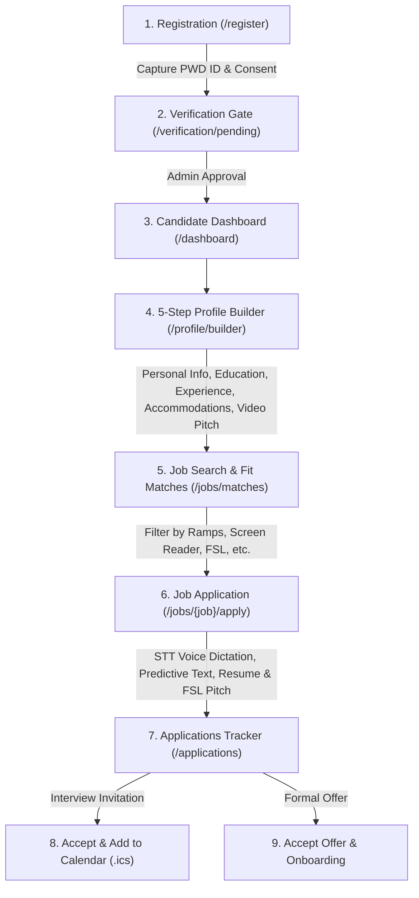
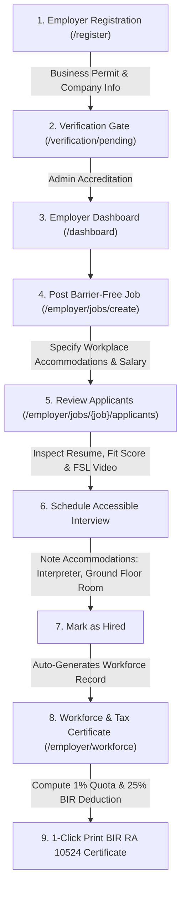
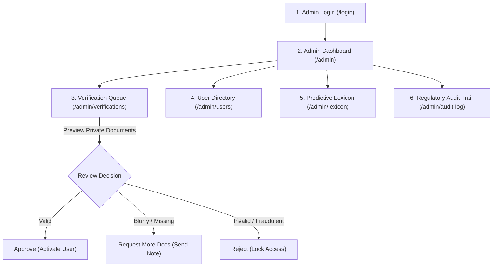

# PWD-E System Workflows & End-to-End User Journeys

This document outlines the complete, production-grade workflows of the **PWD-E Platform** across all three core user roles: **Candidate (Persons with Disabilities)**, **Employer**, and **System Administrator (PESO / LGU Compliance Officer)**.

---

## 1. System Persona & Access Matrix

| Role | Primary Objectives | Key Routes & Components | Regulatory Authority |
|---|---|---|---|
| **Candidate (PWD)** | Register with PWD ID, build accessible profile, search accommodation-filtered jobs, apply via STT/FSL, track hiring status. | `/register` `/profile/builder` `/jobs/matches` `/jobs/{job}/apply` `/applications` | **RA 7277** (Magna Carta for Disabled Persons) **RA 10754** (PWD Benefits) **RA 11106** (Filipino Sign Language Act) **RA 10173** (Data Privacy Act) |
| **Employer** | Register business entity, post accessible opportunities, review applicants, schedule accommodations, hire talent, claim statutory tax incentives. | `/register` `/employer/jobs` `/employer/jobs/create` `/employer/jobs/{job}/applicants` `/employer/workforce` | **RA 10524** (Positions Reserved for PWDs) **BIR RA 10524 / RA 7277 §8** (25% gross wage deduction & 50% accessibility deduction) |
| **Administrator (PESO / LGU)** | Review statutory KYC credentials (PWD ID & Business Permit), monitor compliance, manage predictive assistive lexicon, inspect audit logs. | `/admin` `/admin/verifications` `/admin/users` `/admin/lexicon` `/admin/audit-log` | **DOLE PESO Accreditation** **NCDA / PDAO Guidelines** |

---

## 2. Candidate Workflow (Jobseeker with Disability)

### Detailed Steps:
1. **Registration & Statutory KYC:**
   - Navigates to `/register` and selects **Candidate (PWD)**.
   - Enters Full Name, Email, Password, and Date of Birth (must be $\ge 18$ years old per DOLE Labor Code).
   - Selects Disability Type (Visual, Hearing, Motor/Physical, Speech, Cerebral Palsy, Psychosocial, Intellectual, Multiple).
   - Enters LGU/PDAO-issued PWD ID Number and uploads PWD ID Document.
   - Agrees to explicit RA 10173 Data Privacy sensitive personal information consent.
2. **Account Verification Gate:**
   - Account created in `pending` status. Intercepted by `EnsureAccountVerified` middleware.
   - Displays real-time status banner (`pending`, `needs_more_docs`, `rejected`) with administrative reviewer feedback.
3. **Candidate Dashboard:**
   - Overview of profile strength, recommended jobs sorted by AI Fit Score (%), upcoming interview appointments, and application counters.
4. **Accessible Profile Wizard (`/profile/builder`):**
   - Step 1: Personal Identification & Contact Details.
   - Step 2: Educational Background.
   - Step 3: Work Experience & History.
   - Step 4: Skills, Tools, and Specific Workplace Accommodations Needed (e.g. Wheelchair Ramp, FSL Interpreter, Screen Reader Support, Quiet Room, Flexible Hours).
   - Step 5: Document Uploads & Optional FSL Sign Language Pitch Video.
   - Enforced by server-side `validateStep()` to prevent incomplete profiles.
5. **Smart Job Discovery (`/jobs` & `/jobs/matches`):**
   - Candidate filters jobs by accommodation tags and keyword/location.
   - Algorithm calculates compatibility score based on candidate's disability needs and employer's listed accommodations.
6. **Accessible Application Process (`/jobs/{job}/apply`):**
   - Candidate drafts cover letter using standard keyboard, **Speech-to-Text Voice Dictation**, or Filipino/English predictive text suggestions.
   - Attaches Resume PDF (reused from profile or uploaded fresh) and optional FSL video.
   - Generates formal tracking code (`PWD-APP-2026-XXXXX`) and notifies employer.
7. **Application Lifecycle Tracking (`/applications`):**
   - Tracks real-time stage: `Applied` $\rightarrow$ `Under Review` $\rightarrow$ `Interview` $\rightarrow$ `Offered` $\rightarrow$ `Hired`.
   - Candidate can review interview logistics, requested accommodations, export `.ics` calendar events, and formally accept or decline employment offers.

---

## 3. Employer Workflow (Inclusive Workplace & Tax Incentives)

### Detailed Steps:
1. **Company Registration & Accreditation:**
   - Navigates to `/register` and selects **Employer**.
   - Enters Registered Company Name, Authorized HR Representative Name, Work Email, and Password.
   - Enters LGU Business Permit Number and uploads business accreditation permit under RA 10524.
2. **Administrative Accreditation:**
   - Company profile is gated until verified by PESO/LGU administrator. Gating prevents unverified entities from publishing jobs or contacting PWD candidates.
3. **Employer Dashboard:**
   - Displays RA 10524 Accredited Partner badge, active postings summary, applicant activity, and workforce PWD ratio.
4. **Inclusive Job Creation (`/employer/jobs/create`):**
   - Defines Title, Department, Employment Type (Full-time, Part-time, Remote, Hybrid, On-site), and Salary Range.
   - Selects **Workplace Accommodations Provided** (e.g., Physical ramps, Braille signage, Screen-reader friendly software, Filipino Sign Language interpreter, Adaptive hardware).
5. **Applicant Pipeline Review (`/employer/jobs/{job}/applicants`):**
   - Interactive pipeline with status tabs: `All`, `Applied`, `Under Review`, `Interview`, `Hired`, `Rejected`.
   - Inspects candidate profile, education, certifications, and cover letter.
   - Streams FSL sign language pitch video directly in browser and accesses resume documents via secure private controller.
6. **Accessible Interview Scheduling:**
   - Sets date, time, location or Google Meet URL.
   - Specifically records **Accessibility Accommodations Provided** to ensure barrier-free candidate evaluation.
7. **Candidate Hiring & Workforce Integration:**
   - Employer confirms hire with start date and agreed annual wage.
   - System automatically generates a [WorkforceRecord](file:///C:/Users/ay/Projects/pwd-e/pwd-e-app/app/Models/WorkforceRecord.php) tied to the verified PWD employee.
8. **Statutory Tax Incentives & Quota Tracking (`/employer/workforce`):**
   - Monitors corporate compliance with the **1% PWD Employment Mandate** (RA 10524).
   - Automatically computes the **25% additional gross wage deduction** under Section 8 of RA 7277 / RA 10524 for annual corporate income tax filing.
   - Features a **1-click printable DOLE / BIR Statutory Certification** with official regulatory print headers.

---

## 4. Administrator / PESO Officer Workflow (Regulatory Governance)

### Detailed Steps:
1. **Administrative Authentication:**
   - Log in using designated administrator credentials with elevated Spatie role `admin`.
2. **Administrative Dashboard (`/admin`):**
   - Centralized KPIs tracking pending statutory verifications, published postings, candidate application volume, and registered users.
3. **KYC Verification Queue (`/admin/verifications`):**
   - Central compliance hub for inspecting submitted PWD ID cards and Business Permits.
   - Documents are securely streamed from private storage via `VerificationDocumentController`.
   - Review actions:
     - **Approve**: Immediately transitions user to `active`, sets `verified_at`, and dispatches notification.
     - **Request More Docs**: Logs reviewer remarks (e.g. "Uploaded PWD ID card is expired or unreadable"), setting status to `needs_more_docs`.
     - **Reject**: Logs reason for statutory rejection and sets status to `rejected`.
4. **User & Entity Management (`/admin/users`):**
   - Real-time search and filtering across candidates, employers, and admins.
   - Capability to suspend abusive accounts or reactivate restored entities.
5. **Predictive Lexicon Management (`/admin/lexicon`):**
   - Manages terminology for assistive typing, Filipino Sign Language glosses, and accessibility vocabulary used in predictive text engines.
6. **Immutable Audit Trail (`/admin/audit-log`):**
   - Detailed regulatory activity log recording timestamp, actor, event, and IP address for all approvals, rejections, and profile modifications.

---

## 5. Defense Alignment & Legal Compliance Standards

| Statutory Mandate | System Implementation | Verification / Evidence |
|---|---|---|
| **RA 7277** (Magna Carta for Disabled Persons) | LGU PDAO PWD ID capture, disability categorization, accommodation matching, and private document storage. | [CreateNewUser.php](file:///C:/Users/ay/Projects/pwd-e/pwd-e-app/app/Actions/Fortify/CreateNewUser.php) [VerificationQueue.php](file:///C:/Users/ay/Projects/pwd-e/pwd-e-app/app/Livewire/Admin/VerificationQueue.php) |
| **RA 10524** (Positions Reserved for PWDs) | LGU Business Permit validation, 1% workforce quota tracking, and automatic 25% additional gross wage deduction calculation. | [Workforce.php](file:///C:/Users/ay/Projects/pwd-e/pwd-e-app/app/Livewire/Employer/Workforce.php) [workforce.blade.php](file:///C:/Users/ay/Projects/pwd-e/pwd-e-app/resources/views/livewire/employer/workforce.blade.php) |
| **RA 10173** (Data Privacy Act of 2012) | AES-256 encrypted casts for sensitive PWD ID numbers and health data; private disk document streaming; affirmative consent check. | [VerificationRequest.php](file:///C:/Users/ay/Projects/pwd-e/pwd-e-app/app/Models/VerificationRequest.php) [VerificationDocumentController.php](file:///C:/Users/ay/Projects/pwd-e/pwd-e-app/app/Http/Controllers/Admin/VerificationDocumentController.php) |
| **RA 11106** (Filipino Sign Language Act) | Native FSL video pitch uploads, FSL accommodation filtering, and accessible video review for employers. | [Apply.php](file:///C:/Users/ay/Projects/pwd-e/pwd-e-app/app/Livewire/Candidate/Apply.php) [ProfileBuilder.php](file:///C:/Users/ay/Projects/pwd-e/pwd-e-app/app/Livewire/Candidate/ProfileBuilder.php) |
| **WCAG 2.1 AA** | High-contrast palette, $\ge 44$px touch targets, zero raw icons, dyslexic font toggle, full keyboard navigation, plain page loads (zero `wire:navigate`). | [accessibility-panel.blade.php](file:///C:/Users/ay/Projects/pwd-e/pwd-e-app/resources/views/components/accessibility-panel.blade.php) |
